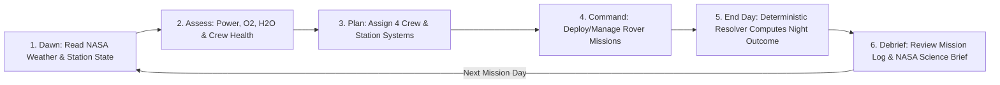
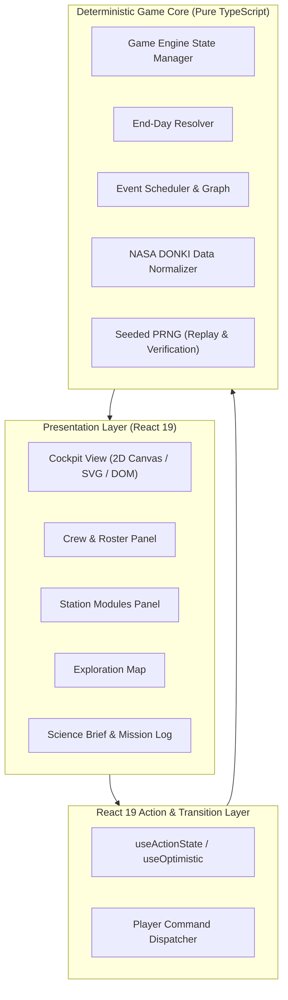

# 🚀 Project Hail — Junior Astronaut Mission Trainer

[](https://react.dev/)
[](https://www.typescriptlang.org/)
[](https://vitejs.dev/)
[](https://api.nasa.gov/)
[](LICENSE)
[](#)

> **A 2D turn-based survival strategy & STEM educational web game empowering junior astronauts (ages 7–12) to command a Lunar Outpost through real engineering trade-offs and authentic NASA space weather data.**

---

## 📖 Table of Contents

- [Overview & Vision](#-overview--vision)
- [Key Features](#-key-features)
- [Core Gameplay Loop](#-core-gameplay-loop)
- [Science & NASA Data Pipeline](#-science--nasa-data-pipeline)
- [Game Systems](#-game-systems)
  - [Resources & Life Support](#1-resources--life-support)
  - [Crew Roster](#2-crew-roster)
  - [Station Modules](#3-station-modules)
  - [Remote Rover Expeditions](#4-remote-rover-expeditions)
  - [Three-Tier Event System](#5-three-tier-event-system)
- [Technical Architecture](#-technical-architecture)
  - [React 19 Modern Architecture](#react-19-modern-architecture)
  - [Engine & UI Decoupling](#engine--ui-decoupling)
- [Project Structure](#-project-structure)
- [Getting Started](#-getting-started)
- [MVP Scope & Roadmap](#-mvp-scope--roadmap)
- [Pedagogical Impact & STEM Goals](#-pedagogical-impact--stem-goals)
- [Contributing](#-contributing)
- [Attribution & References](#-attribution--references)

---

## 🌌 Overview & Vision

Developed for the **NASA Space Apps Challenge**, **Project Hail** places young players in the commander's seat of an advanced Lunar Outpost for a grueling **12 Mission Days** campaign.

Instead of testing passive knowledge through multiple-choice quizzes, Project Hail teaches **authentic engineering trade-offs**:
- *Do we risk power reserves to keep the water recycler active, or preserve battery life to maintain communication with our exploration rover during an impending solar energetic particle event?*

Every choice incurs immediate costs and delayed consequences across multiple turns. Science is never arbitrary: real historical space weather records from **NASA DONKI** directly govern the lunar radiation and environmental conditions.

---

## ✨ Key Features

- 🎮 **Turn-Based 2D Cockpit Experience**: Intuitive 16:9 point-and-click retro cartoon interface tailored for desktop with responsive touch support.
- ☀️ **Real NASA Open Data**: Integrates curated 12-day windows from NASA's Space Weather Database of Notifications, Knowledge, and Information (**DONKI**).
- 🧑‍🚀 **4-Astronaut Crew Management**: Assign tasks, monitor health indicators, and mitigate hazards without micromanagement bloat.
- 🤖 **Remote Rover Exploration**: Plan and deploy uncrewed rover expeditions across 3 treacherous lunar zones (Crater, Regolith Field, Shadowed Region).
- 📊 **Dynamic Daily Science Brief**: Clear, age-appropriate STEM explanations contrasting *observed space weather data*, *simulated station impacts*, and *real-world scientific countermeasures*.
- 🔁 **Deterministic & Replay-Friendly**: Seeded random generator paired with historical NASA timeframes enables repeatable scenario sharing and fair testing.

---

## 🔄 Core Gameplay Loop



### Win / Loss Conditions
* **Victory**: Complete the 12th Mission Day with all **4 astronauts alive** AND gather scientific data from **at least 2 out of 3** rover exploration expeditions.
* **Defeat**: Complete life-support failure, crew casualty, or failure to secure required scientific research milestones by Day 12.

---

## 🛰️ Science & NASA Data Pipeline

Project Hail strictly preserves scientific integrity by distinguishing **Observed Data**, **Inferred Context**, and **Simulated Gameplay**:

```text
       NASA Archive / DONKI API (FLR, CME, SEP events)
                             │
                             ▼
            Curated 12-Day Historical Windows (UTC)
                             │
                             ▼
                 [ NASA Data Mapper Service ]
         (Maps solar events to Lunar radiation & flux context)
                             │
                             ▼
               Mission Environment Timeline
           + Conditional Random Events (weighted)
           + Story & Training Objectives
                             │
                             ▼
    [ Game Engine ] ──> [ End-Day Deterministic Resolver ]
                             │
                             ▼
               Updated State + Science Brief
```

> [!NOTE]
> **No Dust Storms on the Moon!** Unlike Mars, the Moon possesses an ultra-thin exosphere with no wind-driven sandstorms. Environmental events on the Moon focus on solar flares, coronal mass ejections, cosmic rays, and electrostatic regolith dust adhesion.

---

## ⚙️ Game Systems

### 1. Resources & Life Support
- ⚡ **Power (kWh)**: Generated by solar arrays, stored in battery banks. Drives all life-support, heaters, communications, and rover charging.
- 🫧 **Oxygen (kg)**: Replenished by the Oxygen Generator via electrolysis; depleted daily by crew respiration.
- 💧 **Water (L)**: Purified through the Water Recycler with power cost; critical for hydration and health recovery.
- 📦 **Spare Materials**: Auxiliary consumable required for maintaining degraded components.

### 2. Crew Roster
- **4 Astronauts** with equal baseline qualifications for all core modules.
- **Attributes**: `Health (0–100%)`, `Status` (`Available`, `Busy`, `Injured`, `Incapacitated`).
- **Rule**: Exactly **1 primary assignment per crew member per Mission Day**.

### 3. Station Modules
| Module | Core Functionality | Degradation Risks |
|---|---|---|
| **Solar Power Grid** | Primary energy generation and storage | Reduced efficiency during lunar shadow / dust accumulation |
| **Oxygen Generator** | Converts reserves/power to breathable O2 | Critical hazard if broken: rapid crew health depletion |
| **Water Recycler** | Recovers wastewater with electrical overhead | Contamination / water leakage upon system failure |
| **Communication Array** | Relays telemetry to Earth & rover links | Signal dropouts during solar particle storms |
| **Medical Bay** | Treats crew injuries and restores Health | Requires power and assigned personnel |
| **Rover Terminal** | Plots routes, configures instruments, and monitors rover | Inoperable if power is severed |

### 4. Remote Rover Expeditions
Astronauts do not perform EVAs outside the habitat in the MVP. All surface science is conducted via the robotic rover:
1. **Lunar Crater**: High rock density; hazard of wheel entrapment.
2. **Regolith Field**: High electrostatic dust adhesion; tests sensor durability.
3. **Permanently Shadowed Region (PSR)**: Sub-zero cryogenic extremes; targets volatile water-ice deposits.

### 5. Three-Tier Event System
1. **NASA Environmental Events**: Grounded in genuine historical DONKI logs (FLR, CME, SEP).
2. **Conditional Random Events**: Triggered only when contextual criteria are met (e.g., rover stuck only while actively traversing; recycler malfunction only when active or degraded).
3. **Story & Objective Milestones**: Structured narrative checkpoints without forcing fixed calamities on pre-determined days.

---

## 🏗️ Technical Architecture

Project Hail is built with a modern, decoupled web architecture using **React 19** and a **headless TypeScript game engine**.



### React 19 Modern Architecture
- **React 19 Server & Client Paradigms**: Exploits the newest React 19 hooks including `useActionState`, `useOptimistic`, and `useTransition` for lag-free, responsive game actions.
- **Optimistic State Updates**: Allocation of power and crew assignments visualizes instant feedback while the engine guarantees state validation.
- **Zero-Coupling Engine**: The entire game logic, resolver, resource balance equations, and event conditions run in pure TypeScript with **zero dependency on DOM or React**, facilitating 100% automated test coverage with Vitest.

---

## 📁 Project Structure

```text
nsac-hallelujah/
├── public/
│   ├── assets/
│   │   ├── cockpit/             # 2D 16:9 cockpit backgrounds
│   │   ├── crew/                # Astronaut character portraits (WebP)
│   │   ├── rover/               # Rover models and expedition maps
│   │   └── audio/               # Atmospheric SFX and ambient loops
│   └── data/
│       └── nasa-windows/        # Curated 12-day historical DONKI JSON archives
├── src/
│   ├── core/                    # Headless Game Engine (Pure TypeScript)
│   │   ├── constants/           # Resource balance tables, thresholds
│   │   ├── engine/              # State machine, action validators
│   │   ├── events/              # Event catalog, graph & conditional scheduler
│   │   ├── nasa/                # DONKI mapper, solar weather transformers
│   │   ├── resolver/            # End-Day deterministic resolver
│   │   └── types/               # Strict TypeScript definitions
│   ├── components/              # React 19 UI Components
│   │   ├── cockpit/             # Interactive 2D Outpost Hotspots
│   │   ├── panels/              # Crew, Systems, Rover & Inventory Panels
│   │   ├── dialogs/             # Mission Log, Science Brief & Event Modals
│   │   └── common/              # Buttons, gauges, progress indicators
│   ├── hooks/                   # React 19 Game Hooks (useGameState, useActions)
│   ├── state/                   # Store providers and action dispatchers
│   ├── utils/                   # Seeded PRNG, formatters, audio helpers
│   ├── App.tsx                  # Primary game container
│   └── main.tsx                 # Entrypoint
├── tests/                       # Automated engine & balance test suite
├── package.json
├── tsconfig.json
└── vite.config.ts
```

---

## ⚡ Getting Started

### Prerequisites
- **Node.js**: `v20.x` or higher
- **npm** or **pnpm**

### Installation

1. **Clone the repository**:
   ```bash
   git clone https://github.com/your-username/nsac-hallelujah.git
   cd nsac-hallelujah
   ```

2. **Install dependencies**:
   ```bash
   npm install
   ```

3. **Start local development server**:
   ```bash
   npm run dev
   ```
   Open your browser and navigate to `http://localhost:5173`.

4. **Run game engine unit tests**:
   ```bash
   npm test
   ```

5. **Build for production**:
   ```bash
   npm run build
   ```

---

## 🗺️ MVP Scope & Roadmap

### Phase 1: MVP Core (Current Target)
- [x] Complete Game Design Document v2.0 & balance baseline.
- [ ] Decoupled deterministic engine with unit-tested End-Day Resolver.
- [ ] 12 Mission Days game cycle with seedable PRNG.
- [ ] 3 Core Resources (Power, Oxygen, Water) and 4 crew members.
- [ ] Remote Rover with 3 distinct exploration territories.
- [ ] Three-tier event architecture with curated 12-day NASA DONKI dataset.
- [ ] Interactive 16:9 React 19 Cockpit UI with Science Brief report.

### Phase 2: Enhanced Learning & Accessibility
- [ ] Interactive cadet tutorial designed for kids aged 7–12.
- [ ] Historical Date Selector with cached NASA solar timeline lookups.
- [ ] "What If?" Replay Mode: Rewind to a prior critical decision with identical seed to test alternative engineering strategies.
- [ ] Multilingual support (English & Tiếng Việt).

### Phase 3: Future Expansions
- [ ] Mars 36-Sol Expedition Campaign (featuring atmospheric dust storms, MOXIE systems, and Earth-Mars radio latency).
- [ ] Daily live NASA space weather challenges.

---

## 🎓 Pedagogical Impact & STEM Goals

1. **Systems Thinking**: Children observe how interdependent variables (energy, biology, hardware) react under extreme planetary constraints.
2. **Scientific Traceability**: Dispel misconceptions regarding space; every space weather anomaly cites authentic NASA DONKI observation tags.
3. **Resilience & Critical Reasoning**: Emphasizes strategic planning and calculated risk management over reflex twitching or chance.

---

## 🤝 Contributing

Contributions are welcome! Please check out our [Contributing Guidelines](file:///d:/nsac-hallelujah/CONTRIBUTING.md) for branch naming strategies, commit conventions (Conventional Commits), PR templates, and React 19 / TypeScript coding standards.

---

## 📜 Attribution & References

- **NASA Space Apps Challenge**: Junior Astronaut Mission Trainer challenge track.
- **NASA Open Data**: NASA DONKI (Space Weather Database Of Notifications, Knowledge, and Information) API.
- **Educational Framework**: Next Generation Science Standards (NGSS) Earth and Space Sciences.

---

*Project Hail is developed with passion for the junior astronauts and space explorers of tomorrow.* 🛰️🌕

