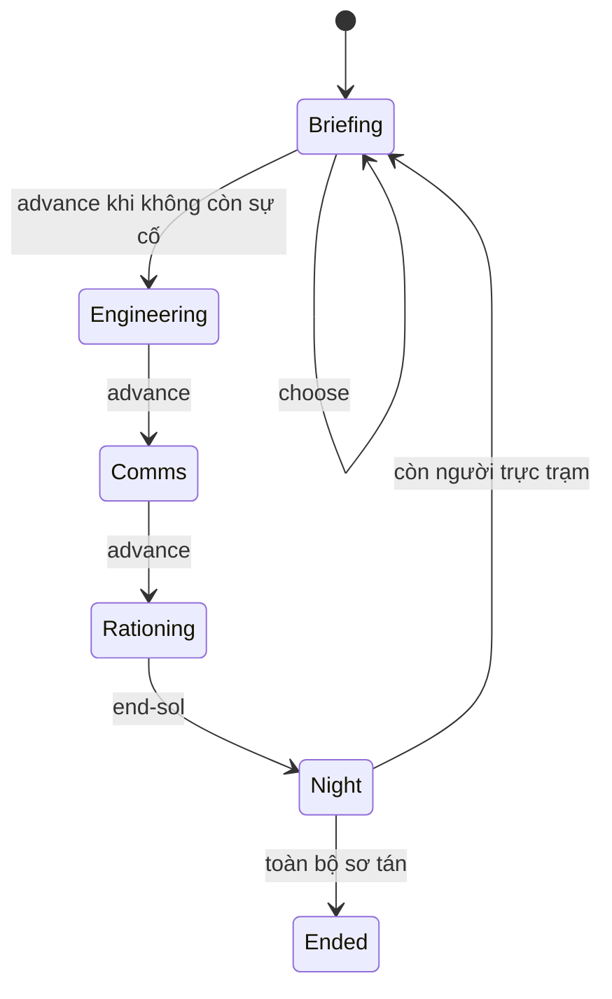
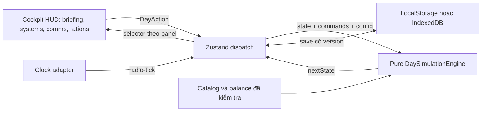

# Junior Astronaut Mission Trainer — Đặc tả kiến trúc

Bản triển khai phục vụ mục tiêu điều hành tiền đồn của [đề bài NASA Space Apps 2026](https://www.spaceappschallenge.org/2026/challenges/junior-astronaut-mission-trainer/). Lõi hiện chạy mô phỏng sinh tồn, quyết định sự cố, nâng cấp, tiếp tế và độ trễ vô tuyến. Bài học che chắn bức xạ hiện nằm trong sự cố EVA. Mô hình liều bức xạ, sản xuất thực phẩm, khử perchlorate và tải nhiệt là phần mở rộng cần thiết cho một bản mô phỏng bao phủ đầy đủ đề bài.

## 1. Khảo sát nhị phân Survival Mode

Nguồn cục bộ là `60Parsecs_Data/Managed/Assembly-CSharp-firstpass.dll`, SHA-256 `245C506F18CFDC1F586AF0A9BDEB4C0396C4B0C8EE5DBA552667CF6E3E3F0EC8`. Các số hex dưới đây là metadata token của chính bản build này. Phân tích đọc metadata và giải mã thân phương thức CIL tĩnh, kể cả `MoveNext` sinh bởi compiler. Các giá trị tuần tự hóa được đối chiếu bằng UnityPy và type tree từ assembly của Unity 2017.4.35f1. Mô tả dưới đây ghi lại hành vi quan sát được. Engine và catalog là thiết kế độc lập.

### Kết thúc ngày

`EndOfDayManager.EndOfDay` (`06002FE6`) khởi chạy coroutine. `ProcessEndOfDay.MoveNext` (`0600464E`) gọi `NotifyEndOfDay` trong vòng xử lý ngày bỏ qua, sau đó cập nhật chuyển cảnh và gọi `NotifyDayStarted`. Thứ tự lớp đến từ constructor `06002FC9`, vòng lặp ở `06004644`. Bên trong lớp, `RegisterOnEndOfDay` (`06002FCF`) sắp xếp bằng `EndOfDayListener.CompareTo` (`06002FDD`) theo số tăng dần. Cùng priority trong cùng lớp có thể bị từ chối theo cờ kiểm tra trùng.

| Thứ tự lớp | Listener xác minh từ các điểm đăng ký CIL |
|---|---|
| EndGame | Hook custom theo cấu hình (`06002FBB`) |
| PreEventSystems | 1 ghi lựa chọn, 3 chuẩn bị Starlog, 4 phái thám hiểm, 5 thiết lập event chế tạo, 6 sửa trạm chế tạo qua view, 7 hoàn tất chế tạo, 20 Scheduler đổi ngày, 21 cập nhật bộ đếm, 90 đặt lại bộ đếm event |
| ReportEvents | 0 Scheduler chạy event kết thúc ngày và dọn event cũ |
| Update | 5 tiêu thụ khẩu phần rồi cộng biến thiên nhu cầu, 10 kiểm tra thu hồi đoàn rồi tăng thời gian nếu còn đi, 15 chạy event của trạng thái đang tồn tại |
| SystemEvents | 5 Scheduler chạy event hệ thống, 10 xử lý trạng thái mất/nhận, 15 cập nhật deck nhân vật, 25 hạ cánh |
| Goals | 4 kiểm tra kết thúc game ở view, 6 lưu cờ tiếp tục, 20 đánh giá mục tiêu |
| PrepareSystem | 0 Scheduler chốt ngày kế, 2 chuẩn bị event view, 4 đặt văn bản ngày mới, 1000 chuyển trạng thái lưu |
| ActionEvents | 0 Scheduler chạy event ngày mới nếu chưa kết thúc game |
| Visuals | 0 kệ vật phẩm, 1 đồng hồ/ô nhân vật, 2 đèn, 3 khẩu phần, 4 hiển thị vật phẩm, 5 hiển thị hệ thống, 6 số khẩu phần, 7 trạng thái hiển thị, max-int hook recorder nếu được cài |
| Reset | 5 xóa dữ liệu khẩu phần, 20 reset vật phẩm thám hiểm, 25 dọn event, 35 đưa panel về báo cáo, max-int hook recorder nếu được cài. 10 reset view chế tạo và 30 reset nút khẩu phần. Các giá trị trường tĩnh lần lượt đến từ 060033EB và 060035E5. |
| ChangeFinished | Nhóm riêng sau chuyển cảnh, 0 Starlog, 10 lớp thống kê/mục tiêu, max-int hook recorder nếu được cài |

Các nguồn đăng ký chính gồm `Scheduler.OnEnable 060032C0`, `RationingManager.CustomStart 0600327C`, `ExpeditionManager.Awake 060031BD`, `CraftingManager.Awake 060033E1` và `ParsecsEventManager.Awake 060023BA`. `SchedulerManager` là lớp điều phối và API lập lịch, còn listener chạy ngày được đăng ký trên `Scheduler`. Bảng biểu diễn thứ tự đăng ký quan sát được trong DLL. Hook có dữ liệu cấu hình, điều kiện kích hoạt scene và tập listener thực tế cần đối chiếu instance trong asset Unity.

### Nhân vật, nhu cầu và trạng thái

- `Character` giữ dữ liệu tĩnh và runtime riêng. `RuntimeCharacterData.UpdateNeedsWithDailyChanges` (`06002F83`) bỏ qua lượt nếu status miễn toàn bộ, bỏ qua need được miễn riêng, rồi dùng `DailyValueChange` đã cấu hình khi trị tuyệt đối đạt điều kiện epsilon quanh 0.001. `ChangeNeedValue` (`06002F7D`) kiểm tra miễn thay đổi, cộng delta, giới hạn về [0, 1] và cập nhật status gắn với need.
- `CharacterNeedParameters.set_Value` (`06002F05`) là FSM năm bậc Min, Low, Normal, High, Max, với ngưỡng lên và xuống tách riêng, có cờ không đảo ngược ở hai đầu. Các phép kiểm tra riêng ở `06002F26–06002F2D`. `RationingManager.CheckStatus` (`06003282`) xử lý trạng thái bị mất trước trạng thái mới, gọi các event exit/enter theo cấu hình, rồi ghi nhận snapshot status.
- `CharacterStatus.get_IsDead` (`06002F5E`) đọc cờ cấu hình, và `RuntimeCharacterData.IsAlive` (`06002F87`) trả về false nếu có status mang cờ đó. Điều kiện còn phụ thuộc mapping ngưỡng/status/event. Bảng dưới đây đối chiếu sáu cấu hình nhân vật đã giải mã từ asset Unity.
- `CharacterAttribute.CalculateTeamAttributeValue` (`06002E9C`) cho kết quả `0.125 × số nhân vật trong danh sách + 0.125 × tổng điểm thuộc tính của người còn sống và được hiển thị trên tàu`. Đây là công thức của game gốc. Trainer dùng chỉ số giáo dục độc lập.

**Cấu hình sáu nhân vật** — `sharedassets0.assets`, PathID 12074–12079. Bốn need được khởi tạo ở 0,5, trạng thái Normal. Các số dưới đây là giá trị hiển thị đã làm tròn từ float Unity. Cột ngưỡng theo thứ tự low, high, riseNormal, riseLow, fallNormal, fallHigh.

| Need | Delta/ngày | Ngưỡng | Status ở Min / Low / High / Max |
|---|---:|---|---|
| Health | 0 | 0,25 / 0,80 / 0,30 / 0,10 / 0,65 / 0,75 | Dead / Weak / Vigorous / Vigorous |
| Hunger | −0,10 | 0,20 / 0,85 / 0,36 / 0,20 / 0,70 / 0,80 | Starving / Hungry / WellFed / WellFed |
| Morale | 0 | 0,25 / 0,75 / 0,40 / 0,25 / 0,60 / 0,50 | Enemy / Insubordinate / Loyal / Friend |
| Sanity | 0 | 0,25 / 0,75 / 0,35 / 0,25 / 0,60 / 0,75 | Insane / Insane / Alert / Alert |

Health về Min kích hoạt Dead và Min là không đảo ngược theo FSM. Sanity xuống Low hoặc Min kích hoạt Insane. Mức Hunger giảm có nghĩa là đói hơn. Các asset không có need riêng cho khát hoặc mệt. Tired và Sick là status riêng (PathID 12133 và 12129), không xuất hiện trong bốn mapping trên. Bộ status đã giải mã dùng Insane (12118) và không có asset status tên Depressed, Crazy hoặc Stroke. Các event có thể thêm status ngoài FSM nhu cầu. Trong sharedassets0.assets, các SurvivalEvent 12681, 12744, 12751 và 12773 có AddStatusNode trỏ đến Sick. Cấu hình mission 13364 và event hệ thống 13368 cũng có node thêm Sick. Event thoát thám hiểm 13020 có node 60609 thêm Tired. Mỗi node chỉ chạy khi nhánh flow tương ứng được kích hoạt.

### Kho tài nguyên, sửa chữa và nâng cấp

`GameResource` chứa định danh tài nguyên, `Amount` và phần dự kiến dùng. `PlayerResources` giữ danh sách runtime, giá trị khởi tạo và trần kho. Các phép cộng/trừ khớp theo định danh và chặn số lượng trong [0, trần] (`060030E9`, `060030EF–060030F1`). Trừ nhiều khoản kiểm tra khả năng khóa trước khi trừ (`060030F6`).

`ShipSystem.GetUpgradeCostForCurrentLevel` (`0600342E`) là hợp đồng. `SimpleSystem` (`06003441`), crafting (`06003398`) và expedition (`06003178`) đọc bảng giá tĩnh theo `level - 1`. `SimpleSystem.Upgrade` (`06003442`) tăng cấp một đơn vị. Giá cụ thể được xác minh trong bảng bên dưới. `CraftingManager.FinishCrafting` (`060033E8`) chờ đến khi tiến độ đạt tổng thời gian trừ một, lập lịch event hoàn tất và xóa trạng thái công việc. Khi chưa đạt, tăng tiến độ một đơn vị.

**Dữ liệu kho và hệ thống** — `sharedassets0.assets`, PathID 11963 (kho) và 13489–13492 (trạm). Kho có trần 999 mỗi loại, với số khởi tạo tuần tự hóa bằng 0 cho Chemical, Mineral và Power. Các hệ thống sau có trần cấp 3.

| Hệ thống | 1 → 2, 2 ngày | 2 → 3, 4 ngày |
|---|---|---|
| Crafting | 30 Power | 60 Power |
| Engine | 40 Chemical + 40 Mineral | 80 Power |
| Expedition | 25 Power | 50 Power |
| Suit | 25 Power | 50 Power |

Đường kích hoạt/sửa Crafting ở `DamagedCraftingPanelController.Repair` (`06003416`) trừ các tài nguyên và vật phẩm theo danh sách yêu cầu. Bản asset của Crafting có hai danh sách rỗng, và phương thức ghi cảnh báo rằng cơ chế kích hoạt này không còn được dùng. Asset Expedition chứa yêu cầu vật phẩm Tape và danh sách tài nguyên rỗng. Giá sửa từng vật phẩm đi theo dữ liệu operation của vật phẩm, tách với giá nâng cấp trạm.

### Đồ thị sự kiện và thám hiểm

- `EventNode` giữ trạng thái pause và truy cập event cha. Resume ở lớp cơ sở có thân rỗng (`06001D29–06001D2C`). `PlayerDecision` là dữ liệu đánh dấu đã chọn và chỉ số lựa chọn (`06001D34–06001D38`). `CalculationNode` ở đây cung cấp kiểu hiển thị editor (`06001D22–06001D24`), công thức nằm trong lớp dẫn xuất. `GetRandomEventFromDeckNode.GetValue` (`060021A5`) đọc đầu vào deck và chọn event. `Deck.GetRandomEvent` (`0600228C–0600228F`) có nhánh rút theo tổng trọng số tích lũy và nhánh rút đều khi tổng không dương. Xác suất từng event và topology của từng graph nằm ngoài phần khảo sát này. Schema JSON của Trainer định nghĩa một định dạng mới.
- `ExpeditionDestination` tách static/dynamic data và cung cấp event, cấp hệ thống tối thiểu, phần thưởng và threat (`060022AA–060022AE`). `ExpeditionThreat` giữ cấu hình, runtime và tham gia lưu trạng thái (`060031E0–060031E8`). `ExpeditionManager.RevokeExpeditionAndUpdateExpeditionTime` (`060031C2`) so elapsed với độ dài event trước khi thu hồi. Nếu còn ongoing sau kiểm tra, tăng elapsed một đơn vị (`060031C6`). Khi phái đoàn, SendExpedition (060031C4) đặt elapsed về 0, rút thời lượng nguyên bằng Random.Range(min, max + 1), lưu độ dài và lên lịch event. BlockThreat và IsThreatBlocked (060031D7, 060031D9) dùng cờ Enabled của runtime threat. Trainer dùng mốc đến tuyệt đối cho tiếp tế và vô tuyến để tái tạo lịch sau khi tải save.

**Dữ liệu graph đã đối chiếu.** Trong `sharedassets0.assets`, `SurvivalEvent` có danh sách con trỏ `nodes`, `_conditionEvents`, tag, tham số nhân vật/vật phẩm và trạng thái đầu/cuối. Mỗi node có `Inputs` và `Outputs` tham chiếu các cổng riêng. Cổng lưu node chủ và liên kết sang cổng nguồn. Đây là graph đối tượng Unity tuần tự hóa.

- Ví dụ `SurvivalEvent` PathID 12903 có các điểm vào Prepare, Action và Report. Graph nối phần hiển thị có/không với node đọc kết quả và điều kiện `If`. Nhánh khác kiểm tra lượng thức ăn khả dụng lớn hơn 0, với một node trừ 1 đơn vị thực phẩm. Các tham chiếu có thể kiểm tra gồm node lựa chọn 106688, node đọc kết quả 65384, node điều kiện 51019 và node trừ 19715.
- Deck nhân vật PathID 12152 có `_deckProbability = 0,5`, bật theo Insane (12118), giới hạn cho crewmate và có tập trạng thái vô hiệu hóa. Hai mục 12903 và 12901 có trọng số 0,5 mỗi mục, nên mỗi mục chiếm 50% **trong lần rút từ deck này khi cả hai còn hợp lệ**. Giá trị 0,5 của deck là tham số riêng ở tầng chọn deck.
- Persist của Sick (13067) và Starving (13075) có các nhánh `If`, kiểm tra PostExpedition và node sửa Health/Morale. Các trường delta dự phòng trên node Health là −0,075 và −0,105 tương ứng. Cả hai node có đầu vào delta được nối, nên cần đọc giá trị từ cổng nguồn để xác định mức áp dụng theo nhánh. Tired persist (13079) chứa đường gỡ Tired (node 122542).
- Khảo sát phân loại được 445 asset SurvivalEvent, 87 SystemStatusEvent và 50 ExpeditionEvent. Đặc tả truy vết một số graph và trạng thái trọng tâm. Mọi đường kích hoạt Sick/Tired, trạng thái cấu hình mission riêng và toàn bộ topology của catalog chưa được tái dựng.

## 2. Hợp đồng mô phỏng Trainer

`src/types/index.ts` định nghĩa hợp đồng readonly. `DaySimulationEngine(state, { config, commands })` áp dụng lệnh theo thứ tự. Lệnh sai phase, không đủ vật tư hoặc ID hàng đợi bị trùng giữ nguyên state. Nhánh RNG dùng seed 32-bit trong save, mỗi lần chọn dùng trọng số tương đối. Mỗi sự cố xuất hiện tối đa một lần sau khi được giải quyết. Điều kiện `when` kết hợp theo AND. Nếu có sự cố chờ, briefing phải được giải quyết trước khi đi tiếp.



`Night` là giao dịch nội bộ, không xuất hiện trong save. Trình tự là phát điện và phân bổ tải thiết yếu → chạy WRS rồi MOXIE nếu đủ điện → rò rỉ và phân phối O₂/nước/thực phẩm → cập nhật phi hành đoàn → tăng Sol và nhập hàng đã đến → kết thúc hoặc chọn sự cố sáng. Hàng đến ở đầu Sol mới nên không được dùng hồi tố cho đêm vừa qua. Lệnh `radio-tick` xử lý riêng ở mọi phase.

### Cân bằng kho, tải và nhu cầu

| Đại lượng | Quy tắc |
|---|---|
| Thời lượng | Lượt Mặt Trăng là một ngày Trái Đất. Lượt Sao Hỏa dùng 88 775 giây, tức khoảng 1,0275 ngày Trái Đất. |
| O₂ | Nhu cầu = 0,84 kg × người đang trực × số ngày. Kho cuối = kho đầu + O₂ từ MOXIE − rò − lượng cấp + hàng đến. Rò bị giới hạn bởi tồn kho. Khẩu phần oxy dự kiến, độ toàn vẹn, cấp ECLSS và điện giới hạn lưu lượng. Các phần khẩu phần áp dụng đồng đều cho người đang trực. |
| Nước | Nhu cầu = 2,5 L × người × ngày. WRS lấy nước thải từ ngày trước, nhân tỷ lệ theo cấp 85/90/93% và độ toàn vẹn. Khi chạy, phần không thu hồi ra khỏi kho hữu dụng. Khi không chạy, nước thải được giữ lại. Nước cấp trong lượt đi vào kho nước thải mô hình hóa. |
| Dinh dưỡng | 0,62 kg chất khô × người × ngày, nhân phần khẩu phần. Thiếu hàng làm giảm đồng đều mức đáp ứng của nhóm đang trực. |
| Điện | `solar = nominal × days × levelFactor × integrity × transmission`. Đêm Sol 15–28 cho hệ số 0 trong chu kỳ mặc định. Bão bụi Sao Hỏa cho hệ số 0,15 ở các cửa sổ cấu hình. Lấy pin đầu cộng điện phát, cấp tải thiết yếu trước, tiếp theo WRS và MOXIE, sau đó nạp pin trong giới hạn dung lượng. Điện vượt dung lượng bị cắt. |
| Sửa/nâng cấp | Sửa dùng 2 kg phụ tùng để hồi integrity về 1. Nâng cấp 1→2 dùng 4 kg, 2→3 dùng 8 kg. Tác dụng theo bảng riêng của mỗi hệ thống. |
| Crew FSM | Thang 0–100. Chỉ số xấu tăng theo phần thiếu và giảm theo phần đáp ứng. Ví dụ khát cộng `28(1 − w) − 12w`. Health cộng 3 rồi trừ thiếu O₂, nước, thức ăn và nghỉ với hệ số 43/15/6/5. Health bằng 0 dẫn đến sơ tán, health ≤ 50 hoặc bất kỳ nhu cầu/stress ≥ 70 dẫn đến suy giảm, các trường hợp còn lại đủ điều kiện trực. Sơ tán là trạng thái cuối. |

0,84 kg O₂ và 0,62 kg chất khô lấy từ bảng nhu cầu danh định. 2,5 L làm tròn từ khoảng 2,37–2,41 kg nước uống và chuẩn bị thức ăn, với 1 L ≈ 1 kg, và đại diện ngân sách cấp nước giản lược. Mức WRS của kịch bản là 85–93%. NASA đã báo cáo hệ ISS đạt tới 98% trong thử nghiệm tích hợp. Các phương trình trên cân bằng từng kho hữu dụng ở biên mô hình, với trao đổi chất, CO₂, nước thất thoát, phụ phẩm MOXIE và nhiệt được gộp vào nguồn/bể ngoài mô hình. `scrubber` là proxy cho khả năng phân phối khí của ECLSS. Các ngưỡng crew là điểm gameplay. [NASA Life Support Overview](https://ntrs.nasa.gov/api/citations/20040035652/downloads/20040035652.pdf), [NASA Life Support System](https://ntrs.nasa.gov/api/citations/20100036823/downloads/20100036823.pdf?attachment=true), [ISS Water Recovery](https://www.nasa.gov/missions/station/iss-research/nasa-achieves-water-recovery-milestone-on-international-space-station/).

NASA mô tả đêm Mặt Trăng khoảng 14,5 ngày Trái Đất và ghi nhận quang năng Opportunity giảm sâu theo độ đục khí quyển. 14 lượt đêm, mức truyền 0,15, cấu hình công suất trạm và sản lượng MOXIE là tham số kịch bản. MOXIE thực nghiệm đã tạo O₂ từ CO₂ Sao Hỏa, đạt tới 12 g/giờ. [NASA Fission Surface Power](https://www.nasa.gov/centers-and-facilities/glenn/nasas-fission-surface-power-project-energizes-lunar-exploration/), [NASA Opportunity Energy](https://science.nasa.gov/resource/on-mars-light-is-energy/), [NASA Perseverance Science Highlights](https://science.nasa.gov/mission/mars-2020-perseverance/science-highlights/).

### Logistics, vô tuyến và sự cố

- Cargo dùng kg; lít nước đổi gần đúng 1:1 sang kg. Mỗi đơn tối đa 80 kg, nhận một lần khi `arrivalSol <= sol`. Mặc định 4 lượt Mặt Trăng và 22 lượt Sao Hỏa. Khoảng 15–30 Sol Sao Hỏa là nén thời gian theo brief dự án. Các chuyến đi thực tế thường tính bằng tháng. [NASA — Thời gian hành trình](https://www.nasa.gov/solar-system/how-long-does-it-take-to-the-moon-mars-jupiter-we-asked-a-nasa-expert-episode-51/).
- Radio dùng thời điểm mili giây trên cùng trục với clock do adapter cấp. Trạm đất nhận ở `sent + latency`, phản hồi đến ở `sent + 2 × latency + groundProcessing`. Kịch bản Mặt Trăng dùng 1.300 ms mỗi chiều. Sao Hỏa mặc định 14 phút, trong dải NASA 4–24 phút. [NASA Communications Latency](https://www.nasa.gov/wp-content/uploads/2023/03/ps-03435-deepspacecomm-508.pdf), [NASA Braided Communications](https://science.nasa.gov/wp-content/uploads/2023/05/188_fed0ad8278e728107533d509b24dc68b_SmithsimmonsDrew.pdf).
- Schema Draft 2020-12 có ba ví dụ đi kèm catalog dùng được. Bão hạt Mặt Trời minh họa quyết định trú ẩn; rò O₂ minh họa cô lập hoặc thay gioăng; bụi regolith minh họa đánh đổi vật tư với hiệu năng lọc. Trọng số và thiệt hại là giả định gameplay. [NASA Artemis Solar Particle Events](https://science.nasa.gov/missions/artemis/artemis-2/to-protect-artemis-ii-astronauts-nasa-experts-keep-eyes-on-sun/), [NASA Lunar Dust and Hardware](https://ntrs.nasa.gov/api/citations/20220006415/downloads/46th_AMS_Proceedings_Final.pdf).

## 3. Hướng dẫn tích hợp Cockpit HUD

Trong app Vite/React, cài `npm install zustand` và `npm install -D typescript vitest ajv`. Giữ cấu hình engine hiện có khi ghép tsconfig của Vite. Chạy `npx tsc --noEmit` và `npx vitest run` trong CI. Dùng Ajv 2020 để kiểm tra `events.json` với schema và kiểm tra ID sự cố, ID lựa chọn trong từng event là duy nhất. Đặt type guard hoặc decoder ở biên để JSON sau kiểm tra có kiểu `GameEvent[]`. Với fixture tĩnh, khai báo chính xác literal discriminant ở adapter hoặc dùng decoder. Áp dụng tương tự cho save, đặc biệt phase, seed, ID hàng đợi và event đang chờ. [Zustand persist](https://zustand.docs.pmnd.rs/reference/integrations/persisting-store-data), [Vitest Guide](https://vitest.dev/guide/learn/writing-tests).



Đặt adapter dưới `src/store/`. `initialState` và `config` dưới đây là dữ liệu JSON đã được kiểm tra ở biên ứng dụng.

```ts
import { create } from 'zustand';
import { createJSONStorage, persist } from 'zustand/middleware';
import { DaySimulationEngine } from '../engine/DaySimulationEngine';
import type { DayAction, GameState, SimulationConfig } from '../types';

type MissionStore = {
  game: GameState;
  dispatch: (action: DayAction) => void;
};

export function createMissionStore(initialState: GameState, config: SimulationConfig) {
  return create<MissionStore>()(persist(
    (set) => ({
      game: initialState,
      dispatch: (action) => set((store) => {
        const game = DaySimulationEngine(store.game, { config, commands: [action] });
        return game === store.game ? store : { game };
      }),
    }),
    {
      name: 'junior-astronaut-mission-v1',
      version: 1,
      storage: createJSONStorage(() => localStorage),
      partialize: ({ game }) => ({ game }),
    },
  ));
}
```

Khởi tạo store một lần bên ngoài chu kỳ render. HUD chọn từng lát dữ liệu bằng selector, ví dụ `useMissionStore(s => s.game.resources.oxygenKg)`. Khi thay cấu trúc save, tăng version và cung cấp `migrate`. Khi dùng storage bất đồng bộ, chờ hydrate trước khi cho điều khiển. Kiểm tra save đã decode trước khi merge, rồi đưa save hỏng về màn hình khôi phục. Khi đổi catalog, migrate cả ID của sự cố đang chờ. Chỉ cho một tab điều khiển cùng save, hoặc dùng cơ chế khóa/đồng bộ tab của adapter.

Dùng `Date.now()` ở adapter và gửi `radio-tick` ngay trước khi gửi radio, sau hydrate và tại mốc đến gần nhất. Hiển thị đồng hồ đếm ngược trong UI bằng thời gian render cục bộ. Chỉ dispatch khi có mốc nghiệp vụ, để tránh ghi localStorage mỗi khung hình. Trạng thái mission, seed, hàng đợi và thời điểm nhận được giữ qua reload. UI có thể hiển thị lời phản hồi CAPCOM theo kịch bản khi status thành `reply-received`.

Hiển thị dòng số liệu theo đơn vị và tách rõ dự báo của ca đêm với hàng đang bay. Đo FCP < 2 giây, bundle nén < 2,5 MB và mục tiêu 60 FPS trên build Cockpit thực tế. Engine có thể chạy trong môi trường test Node. Dùng WebP/SVG cho art và giữ animation nền ngoài luồng dispatch.

### Viết test Vitest

Tạo `src/engine/DaySimulationEngine.test.ts`, nạp fixture đã định kiểu, đặt phase `rationing` và gọi reducer bằng `end-sol`. Dùng `toBeCloseTo` cho số thực. Ví dụ với fixture mặc định hai người:

```ts
import { expect, it } from 'vitest';
import { DaySimulationEngine } from './DaySimulationEngine';

it('balances oxygen and water across consecutive turns', () => {
  const first = DaySimulationEngine({ ...fixture, phase: 'rationing' }, {
    config,
    commands: [{ type: 'end-sol' }],
  });
  expect(first.resources.oxygenKg).toBeCloseTo(32 - 2 * 0.84);
  expect(first.resources.waterL).toBeCloseTo(24 - 2 * 2.5);
  expect(first.resources.wasteWaterL).toBeCloseTo(5);
});
```

| Nhóm test | Kỳ vọng |
|---|---|
| Nước | Đêm thứ hai thu hồi 4,25 L từ 5 L trước đó ở WRS cấp 1. Cúp điện giữ nước thải để dùng sau. |
| Điện | Sol 14 còn nắng và Sol 15 mất điện mặt trời. Sao Hỏa Sol 8 bật suy giảm bụi. Pin không âm và không vượt dung lượng. |
| Nhu cầu | Cạn O₂ làm giảm health, kho không âm. Người sơ tán không tính vào nhu cầu lượt sau. |
| Hậu cần | 80 kg hợp lệ, trên 80 kg bị từ chối. Cargo đúng mốc đến và nhập đúng một lần. |
| Radio | Mặt Trăng ở +1.300 ms chuyển sang chờ. Phản hồi tới ở +3.600 ms với thời gian xử lý 1.000 ms. |
| RNG/FSM | Cùng seed và chuỗi lệnh cho cùng kết quả. End Sol lặp ngay sau lần hợp lệ bị bỏ qua. Không thể qua briefing khi còn lựa chọn. |


### Phụ lục CIL — Điều kiện của FSM nhu cầu

Với giá trị `x` đã được giới hạn về [0, 1], các guard dưới đây áp dụng tùy trạng thái trước. Các giá trị ngưỡng là thuộc tính trên đối tượng cấu hình.

| Hướng chuyển | Guard |
|---|---|
| Lên Max | `Approximately(x, 1)` |
| Xuống Min | `Approximately(x, 0)` |
| Xuống High | `fallNormal < x <= fallHigh` |
| Lên High | `high <= x < 1` |
| Xuống Normal | `low < x <= fallNormal` |
| Lên Normal | `riseNormal <= x < high` |
| Xuống Low | `0 < x <= low` |
| Lên Low | `riseLow <= x < riseNormal` |

Setter thử các guard sau theo thứ tự. Max thử xuống High, Normal, Low, Min nếu có thể đảo ngược. High thử lên Max, rồi xuống Normal, Low, Min. Normal thử lên Max, High, rồi xuống Low, Min. Low thử lên Max, High, Normal, rồi xuống Min. Min thử lên Max, High, Normal, Low nếu có thể đảo ngược. Tham chiếu `06002F05`, `06002F26–06002F2D`.

### Kiểm chứng bản bàn giao

TypeScript strict typecheck đã chạy trên mã nguồn. 9 ca Vitest trong thư mục kiểm thử tạm đã qua, gồm xác thực catalog bằng Ajv Draft 2020-12, bảo toàn kho O₂/nước, mất điện WRS, ngày/đêm Mặt Trăng, bão bụi Sao Hỏa, FSM và replay RNG, nhập hàng đúng một lần, độ trễ vô tuyến và giới hạn nâng cấp/sơ tán.


